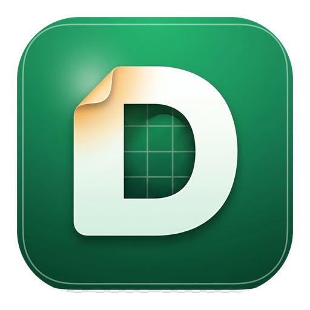

# DraftCalc — downloads

*[Versão em português](README.md)*

DraftCalc is a spreadsheet for macOS and Windows, made as a hobby.
**It is free and accepts no payment of any kind**: no sales, subscriptions, ads or donations.
It is not a commercial offering and is not in any app store.

Based on [GridCraft](https://github.com/storytold/gridcraft) (MIT OR Apache-2.0), with its own
interface, icons and themes. License notices and attributions ship inside each package.

## Downloads

| System | File | Notes |
|---|---|---|
| macOS 11+ (Intel and Apple Silicon) | [`macOS/`](macOS/) — universal `.dmg` | Signed with a Developer ID and notarized by Apple: opens without warnings. Drag DraftCalc to Applications. |
| Windows 10/11 (x64) | [`windows/`](windows/) — `.msi` or portable `.zip` | No code-signing certificate: on first launch SmartScreen may warn; choose "More info › Run anyway". |

Each file has a `.sha256` next to it for verification.

## How to install

### macOS

1. Open the [`macOS/`](macOS/) folder, click the `.dmg` file, then the **Download** button.
2. Open the downloaded file. A window shows the DraftCalc icon next to the Applications folder.
3. Drag DraftCalc onto Applications.
4. Launch DraftCalc from Launchpad or the Applications folder. There is no warning: the app is notarized by Apple.
5. You can eject the "DraftCalc" disk and delete the `.dmg`.

### Windows

1. Open the [`windows/`](windows/) folder, click the `.msi` file, then the **Download** button.
2. Double-click the downloaded file.
3. If the blue "Windows protected your PC" screen appears, click **More info**, then **Run anyway**. The button only shows after "More info". That is SmartScreen noting the app has no paid certificate; it happens on the first run only.
4. Follow the installer: accept the license, Install, Finish. It may ask for an administrator password.
5. DraftCalc is in the Start menu.

**Not allowed to install programs?** Download the portable `.zip`, unzip it into a folder of yours (Documents, for example) and open the `DraftCalc.exe` inside. Nothing is installed.

### Updating

Download the new version's file and install it over the old one. Your workbooks stay where you saved them; the installation does not touch them.

## Current version

0.7.0-draftcalc.2 (October 15, 2026).

What's new: full ribbon with the same visual identity as DraftWord (121 Manzana Line icons, redesigned header, menus and dialogs); menus, dialogs, native macOS menu and help for 514 functions in Portuguese; visual review of dialogs in light and dark; fix for menus staying open over the dialog. The previous release (draftcalc.1) brought the Manzana interface in three looks, three languages, AutoSave and recovery, the Close button and `.xlsx`, `.csv` and `.tsv` support.

## Source code

DraftCalc's source lives in a private repository. This repository holds only the installers.
